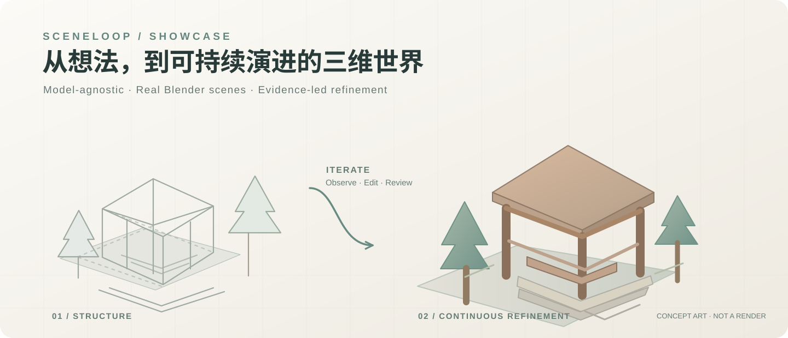
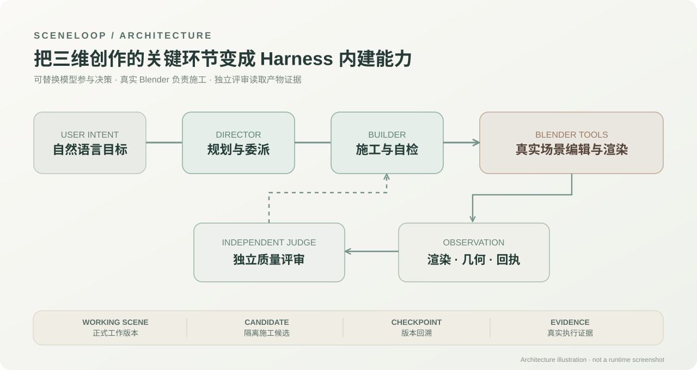

# SceneLoop

**面向真实 3D 场景创作的可替换模型 Agent Harness**：让通用大模型在受控、可观察、可回溯的流程中持续操作 Blender，而不只是输出一段建模脚本。



> 上图为设计示意图，不是运行截图。真实施工与实验成果请参见参赛作品集及下方证据说明。

### 不只是“让 AI 操作 Blender”

Codex 等通用 Agent 已可以持续维护工程、编写 Blender 脚本并自行组织工作流。SceneLoop 探索的差异是：**把三维创作中反复需要的场景状态、受控操作、真实渲染与几何证据、独立评价及版本回溯，沉淀为专用 Harness 的内建机制**，而不是每次重新搭建流程。

系统将模型决策与 Blender 操作协议解耦，同时研究不同模型和 Harness 在建模、材质及精修方面的有效方法，让 Skill、程序化模板和工具资产能够跨任务复用。



### 有证据的实际进展

一次 Test1 / Showcase-R3 实际运行记录了 **16 次 Builder 模型调用、23 次工具调用、3 次草稿编辑，并正式保存为 Working Version 4**。独立 Judge 在逐项检查中判定 **3/7 项通过，整体返回 `continue`**：它不仅指出已改善之处，也继续反馈屋面、地形、石雕及道具的可见不足。

这展示了 **自主施工 + 独立反馈** 的工作方式，但不能据此声称所有场景均能无故障运行。当前原型的长流程交接与恢复仍有待持续修复。

- [查看案例事实、来源区分与当前状态](docs/SHOWCASE_NOTES.md)
- [独立材质方法库 realistic-materials-skill](https://github.com/RobotQv/realistic-materials-skill)

## 主要功能

- **自然语言工作台**：在同一聊天入口进行场景讨论、创建、修改和进度查询。
- **真实场景观察与编辑**：使用 Blender 执行受控建模、材质、灯光及场景编辑，生成真实渲染和几何证据。
- **多角色协作**：Director 负责全局规划，Builder 负责局部施工，Judge 独立评审。
- **项目与版本管理**：以项目文件夹管理连续工作，区分正式 Working Scene、施工候选与检查点，保留保存回执和历史记录。
- **资产接入**：包含外部 GLB 导入、Tripo 云端适配和本地 Hunyuan 适配；实际可用能力取决于配置、模型环境及相应授权。
- **有界自主执行**：管理调用、草稿、正式保存和生成资源；支持资源申请、暂停与恢复。
- **预览与反馈**：提供真实渲染预览、结构诊断视图、执行进展和质量反馈。

## 运行环境

| 组件 | 要求 |
| --- | --- |
| Python | 3.10 或更新版本；工作台后端主要使用标准库 |
| Blender | 需单独安装；当前开发环境使用 Blender 5.2.1 |
| 浏览器 | 支持现代 JavaScript 的浏览器，如 Chrome、Edge |
| 模型服务 | 自行配置兼容的模型服务及凭据 |
| 本地 Hunyuan（可选） | 需独立准备推理环境、模型权重和合适的 GPU/内存资源 |

工作台前端为原生 HTML / JavaScript / CSS，启动不需要 npm 安装或前端构建。Hunyuan 使用自己的 Python 环境，其 PyTorch、CUDA 等依赖不属于工作台的基础运行依赖。

## 快速启动（Windows）

### 1. 解压并打开终端

在包含本 README、`sceneloop` 和 `ui` 的目录中打开 PowerShell。

可选：为工作台创建独立 Python 环境：

```powershell
python -m venv .venv
```

下列命令使用该环境的 Python，不需要修改 PowerShell 执行策略。若使用已有环境，将 `.\.venv\Scripts\python.exe` 替换为 `python` 即可。

### 2. 指定 Blender 并启动

```powershell
$env:BLENDER_PATH = 'C:\Program Files\Blender Foundation\Blender 5.2\blender.exe'
.\.venv\Scripts\python.exe -m sceneloop.server --port 8765
```

请将 Blender 路径替换为实际安装位置。打开浏览器访问：

**http://localhost:8765/**

若端口已占用，可改为 `--port 8766`，并访问对应地址。服务运行期间保留终端；停止服务使用 `Ctrl+C`。启动服务本身不会自动提交生成任务。

### 3. 配置模型

在工作台设置中添加所需配置：

- 大脑模型：设置 Provider、服务地址、模型名称和 API Key，供角色推理使用；Judge 可按工作台选项设置。
- 生图模型：按需配置，未使用生图流程时无需填写。
- 3D 生成：按需配置 Tripo 或本地 Hunyuan；本地模式需要填写已安装环境和模型的位置。

API Key 可以通过工作台输入，按现有凭据机制保存在本机。也可采用 `.env.example` 中列出的环境变量方式。首次启动会创建缺失的 `.env`，已有文件不会被覆盖；修改环境配置后重新启动服务。

本包不包含 API Key、已保存账户配置、模型权重或第三方推理环境。云端服务的实际费用与额度以供应商为准。

### 4. 开始使用

1. 通过“打开 / 创建项目”选择一个用于当前场景的项目文件夹。
2. 在聊天框中描述想创建的场景或需要改进的内容；如需参考图，按界面入口附加并明确用途。
3. 查看聊天中的工作进展，在预览区域查看真实场景结果。
4. 需要批准资源或外部生成时，根据原请求的审批提示处理。
5. 正式保存后的场景作为 Working Scene 继续使用；候选与历史预览不自动等同于当前工作版。

例如：

> 创建一处山林中的小型驿站，有木棚、石阶、休息区与生活物资。保持清晰的入口和行走空间，区分木材、石材与地面，并根据真实渲染逐步完善。

模型和生成能力依赖实际配置。可以先进行小规模场景创建或修改，再根据实际运行情况调整目标与资源。

## 源码目录

```text
SceneLoop/
├─ README.md
├─ .env.example                 # 空白配置示例
├─ sceneloop/                   # 后端、Provider、Blender 适配与执行协议
│  ├─ server.py                 # 本地 HTTP 服务入口
│  ├─ runtime.py                # Run 生命周期
│  ├─ director_runtime.py       # Director 调度
│  ├─ visual_agent.py           # Builder 工具执行循环
│  ├─ judge.py                  # 独立评审
│  ├─ project_state_store.py    # 项目状态与保存事务
│  ├─ blender_adapter.py        # Blender 适配
│  ├─ providers.py             # 模型请求与协议
│  └─ resources/               # 运行所需的方法资源
└─ ui/                          # 原生工作台界面
```

运行时会在本机生成服务配置、项目元数据、SQLite、候选及渲染等数据。请妥善保留所选项目文件夹；源码包本身不包含用户项目或场景产物。

## 当前状态

**在有限测试内偶有异常阻塞，暂未完全修复。**

运行完成、正式保存和 Judge 质量通过是不同状态，应分别查看实际结果。出现异常时保留项目与原运行记录，避免对结果尚未确认的外部请求重复提交。

本源码提交基于 `codex/showcase-integration`，版本 `0f4f8c493aaf98a520f593bd0184861af6deac20`。交付仅包含功能源码、运行资源和本说明，不含测试、施工记录、任务交接、历史报告、Git 历史、用户数据或模型权重。
